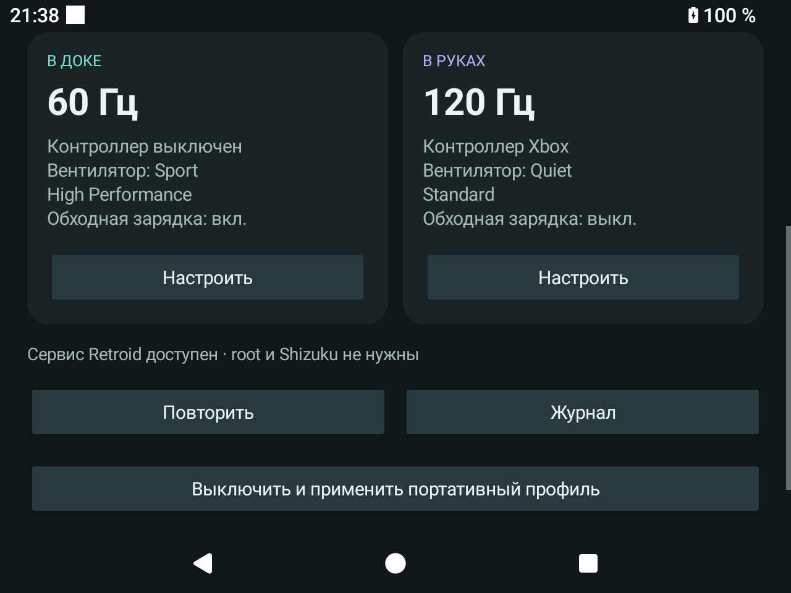
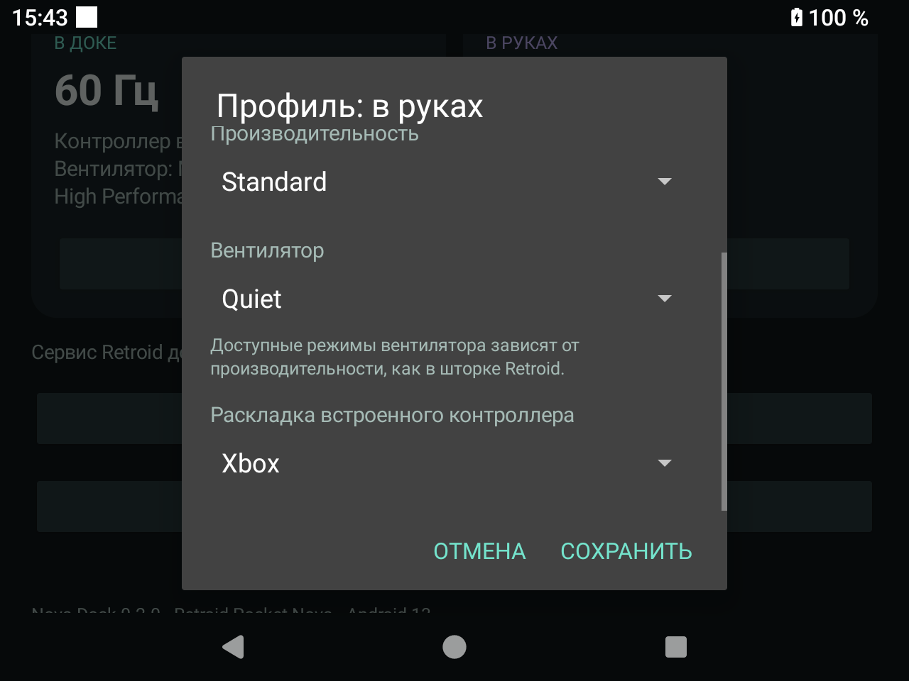

# Nova Dock

[](https://github.com/bseleng/nova-dock/actions/workflows/build.yml)
[](https://github.com/bseleng/nova-dock#compatibility)
[](LICENSE)
[](https://github.com/bseleng/nova-dock/releases)

Configurable docked and handheld profiles for **Retroid Pocket Nova**. Choose the refresh rate, fan and performance preset for each mode, and the built-in controller layout to restore when undocking.

**[Download APK](https://github.com/bseleng/nova-dock/releases/tag/v0.3.0)** · **[Русская документация](docs/README.ru.md)** · **[Report an issue](https://github.com/bseleng/nova-dock/issues/new?template=bug_report.yml)**

> **Early prototype.** A physical dock/undock cycle has been confirmed by the owner on a real Nova. Configurable presets and automatic handheld startup after a real reboot are tested on the device. Docked reboot recovery, long-term behavior and other firmware versions remain unverified.

## Default profiles

| Setting | Docked | Handheld |
|---|---|---|
| Refresh rate | **60 Hz** | **120 Hz** |
| Built-in controller | Disabled | Xbox layout |
| Fan | Maximum | Quiet |
| Performance | High Performance | Standard |
| Bypass charging | **Enabled** | **Disabled** |

## Customize each profile

Tap **Настроить** / Configure on either profile card:

- **Refresh rate:** Leave unchanged, 60 Hz or 120 Hz, independently for each profile.
- **Fan:** Off, Quiet, Smart, Sport or Maximum, where supported by the selected performance preset.
- **Performance:** Standard, Performance or High Performance.
- **Bypass charging:** an independent switch in each profile; on by default in the dock and off in handheld mode.
- **Handheld controller:** Xbox or Retro. The built-in controller remains disabled in the docked profile.

Changes are saved on the device. Editing the currently active profile applies it immediately when automation is enabled. Defaults preserve the original 60 Hz dock / 120 Hz handheld behavior.

| Performance preset | Available fan presets |
|---|---|
| Standard | Off, Quiet, Smart, Sport, Maximum |
| Performance | Quiet, Smart, Sport, Maximum |
| High Performance | Smart, Sport, Maximum |

These combinations follow the stock quick settings UI. The refresh option controls the same Retroid setting as the frequency tile. **Leave unchanged** does not write either refresh-rate setting; it does not restore an earlier rate. External display modes are still negotiated by the firmware.

Bypass charging uses Retroid's stock charging-separation mode. Charging limits and sleep behavior remain controlled by the firmware. Upgrading adds the new defaults while preserving existing profile choices and original-setting snapshots.

## Screenshots

Captured directly from the Retroid Pocket Nova running version 0.3.0 (1280 × 960). Open a caption to view the original screenshot.

| [Main screen](docs/images/overview.png) | [Profile cards](docs/images/profiles.png) |
|---|---|
|  |  |
| [Docked profile editor](docs/images/dock-profile.png) | [Handheld profile editor](docs/images/handheld-profile.png) |
|  |  |


Nova Dock leaves Retroid's built-in **turn off the internal screen when connected to a TV** option in control of the display backlight.

## Getting started

1. Download and install the APK from [Releases](https://github.com/bseleng/nova-dock/releases/tag/v0.3.0).
2. Open **Nova Dock**, configure the two profiles if needed, and enable **Автоматический режим** / automatic mode.
3. Allow notifications so the current profile and stop action remain accessible.
4. Connect or disconnect your external display. Allow about **5 seconds** for the connection to settle and the profile to apply.

No root installation, Shizuku or ADB permission grant is required on the tested stock firmware. A computer is not needed for normal operation.

Turning automation off restores the handheld profile. The app can also restore the settings saved before its first profile application. Stop automation or restore those settings before uninstalling.

## Startup after reboot

Enable automatic mode once. When Android finishes booting, Nova Dock starts its foreground service and applies the saved profile for the current display connection. Opening the app after each reboot is unnecessary. If automatic mode was turned off, the boot receiver leaves it off.

On version 0.3.0, a real reboot with no external display was verified without opening Nova Dock: Android started `BootReceiver` for `BOOT_COMPLETED`, the foreground service applied the handheld profile, and the launcher remained in the foreground. Profile choices and original-setting snapshots were preserved. See the compatibility notes below for the tested firmware and remaining checks.

## How it works

- Reads the physical DisplayPort connection, with Retroid properties and Android presentation displays as fallbacks.
- Uses display callbacks and firmware events, plus a lightweight periodic check.
- Waits for a stable connection and ignores unknown sensor states.
- Applies the same system settings used by Retroid's quick settings tiles.
- Reapplies and verifies the fan setting after firmware performance/fan coupling settles.
- Rechecks the saved fan and bypass presets after power-status and wake events. Charging changes settle before the fan is restored, without reconnecting the controller.
- Extends the saved original-settings snapshot only for newly managed settings, preserving older original values.
- Runs a foreground service with a notification and supports startup after boot when enabled.
- Has no internet permission, analytics, game-file access or emulator configuration changes.

Retroid's stock **`PServerBinder`** service executes the settings commands with its own privileged identity. Nova Dock does not install root access. This is a vendor-specific interface, not a public Android API; an OTA can change its availability. The command adapter accepts only a fixed list of nine settings and numeric values, and exposes no external command-execution endpoint.

<details>
<summary>System settings used</summary>

```text
min_refresh_rate
peak_refresh_rate
performance_mode
fan_mode
fan_speed
temp_abxy_layout_mode
no_create_gamepad_button_layout
flip_button_layout
is_charging_separation
```

On the tested firmware, Standard is `performance_mode=0`, High Performance is `2`, Quiet is `fan_mode=1`, and maximum custom fan speed is `fan_mode=6` with `fan_speed=35000`. Bypass charging is `is_charging_separation=1`; normal charging is `0`. Thermal protection is not modified.

</details>

## Compatibility

| Device | Android | Firmware | Status |
|---|---|---|---|
| Retroid Pocket Nova | 13 / API 33 | `RPN_V1.0.0.436` | Physical dock/undock cycle confirmed; configurable profile checks passed |

Measured on the device:

- **Dock profile:** `60.000004 Hz`, fan PWM `35000`, no gamepad exposed through `InputDevice`.
- **Handheld profile:** `120.00001 Hz`, Quiet PWM `12000`, `Xbox Wireless Controller` restored.
- All eight setting values matched the intended profiles; the self-test restored the previous values afterward.
- Foreground automation started and applied the handheld profile without an external display.

The owner completed a real TV connection/disconnection cycle with the initial prototype and reported expected operation. The transition log confirmed both modes, with no repeated profile application during the dock session.

In 0.2.0, on-device tests also verified Smart/Performance while leaving frequency unchanged, and Sport/Performance/Retro at 60 Hz. A simulated charging-status change reproduced the stock Smart override; the saved Quiet preset was restored in about 1.7 seconds without changing the controller device ID or refresh settings.

In 0.3.0, the stock bypass switch and the charging driver were verified in both directions: enabled produced `usb_charge_now=0`, disabled produced `1`. Tests covered the opposite user choices, saving from the real UI, upgrading an older original-settings snapshot and restoring all nine previous setting values. Existing profile choices were preserved.

A real handheld reboot on 0.3.0 also passed: `BOOT_COMPLETED` started the foreground service without opening the activity; the saved 120 Hz / Xbox / Quiet / Standard / normal-charging profile was applied about three seconds after service startup. The charging driver reported `usb_charge_now=1`. Saved profile choices and original-setting snapshots were unchanged.

Reboot recovery with an external display connected, long-term background survival, objective TV frame-pacing measurements and each emulator's controller/session handling remain unverified. The app currently accepts only Nova on Android 13.

## Build

Requires **Python 3.9+**, **JDK 17**, **Android SDK Platform 35** and **Build Tools 35.0.0**. macOS and Linux are supported. No Gradle or third-party libraries are used.

```sh
git clone https://github.com/bseleng/nova-dock.git
cd nova-dock
python3 build.py
```

Output: `dist/Nova-Dock-0.3.0.apk`. The build verifies the APK signature and runs the connection-state tests.

Optional variables: `ANDROID_SDK_ROOT` / `ANDROID_HOME`, `NOVA_JAVA_HOME` / `JAVA_HOME`, `NOVA_BUILD_DIR`, `NOVA_APK_PATH`.

A local development signing key is created under `keys/` and excluded from Git. Keep it to sign future compatible updates. Builds signed with a different key cannot update an existing installation. Published APKs use the maintainer's retained local key; CI only checks that the project builds.

This pre-release is a debuggable development build with on-device instrumentation. It is intended for testing rather than store distribution.

## On-device checks

Read-only diagnostic:

```sh
adb shell am instrument -w local.nova.dock/.DeviceCheck
```

Test both profiles **with the external display disconnected**. This temporarily changes the nine settings and restores the previous values afterward:

```sh
adb shell am instrument -w -e profiles true local.nova.dock/.DeviceCheck
```

To also test non-default profiles and **Leave unchanged**:

```sh
adb shell am instrument -w -e profiles true -e customProfiles true local.nova.dock/.DeviceCheck
```

Instrumentation restarts the application process. Reopen Nova Dock afterward to resume an enabled foreground service:

```sh
adb shell am start -n local.nova.dock/.MainActivity
```

## Contributing

See [CONTRIBUTING.md](CONTRIBUTING.md). Reports with firmware version, dock/TV model and transition logs are useful while compatibility is being validated.

The vendor interface was investigated on the owner's device; [Hugminn](https://github.com/Ninte86hl/Hugminn) also documents the same stock Retroid service. No vendor APKs, decompiled vendor sources, private device logs or signing keys are included in this repository.

## License

[MIT](LICENSE) — Copyright © 2026 Bogdan Selenginskiy.
