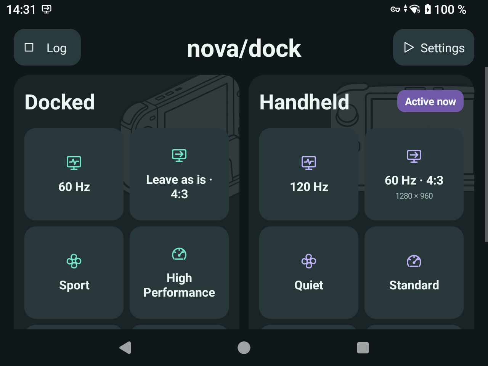
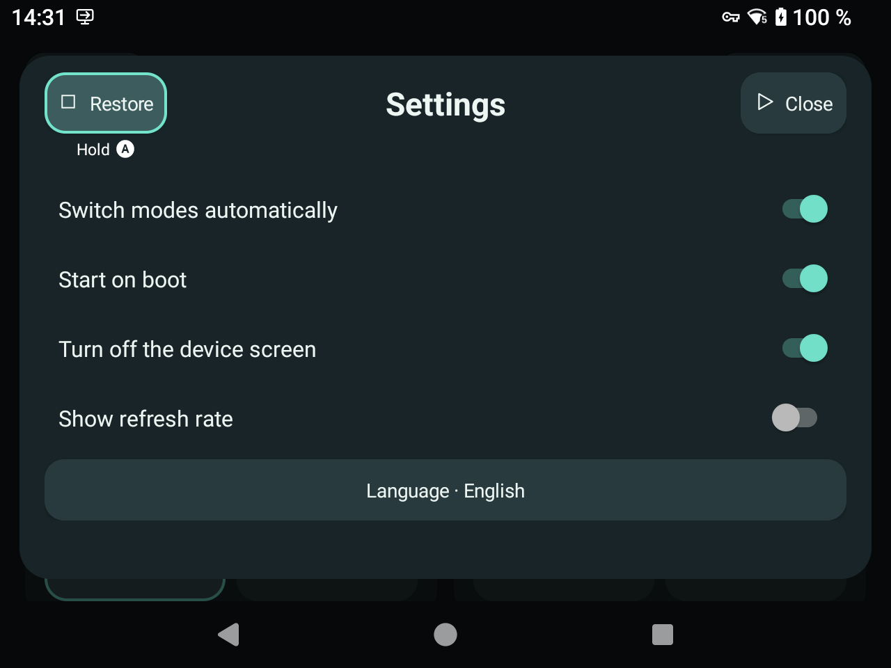
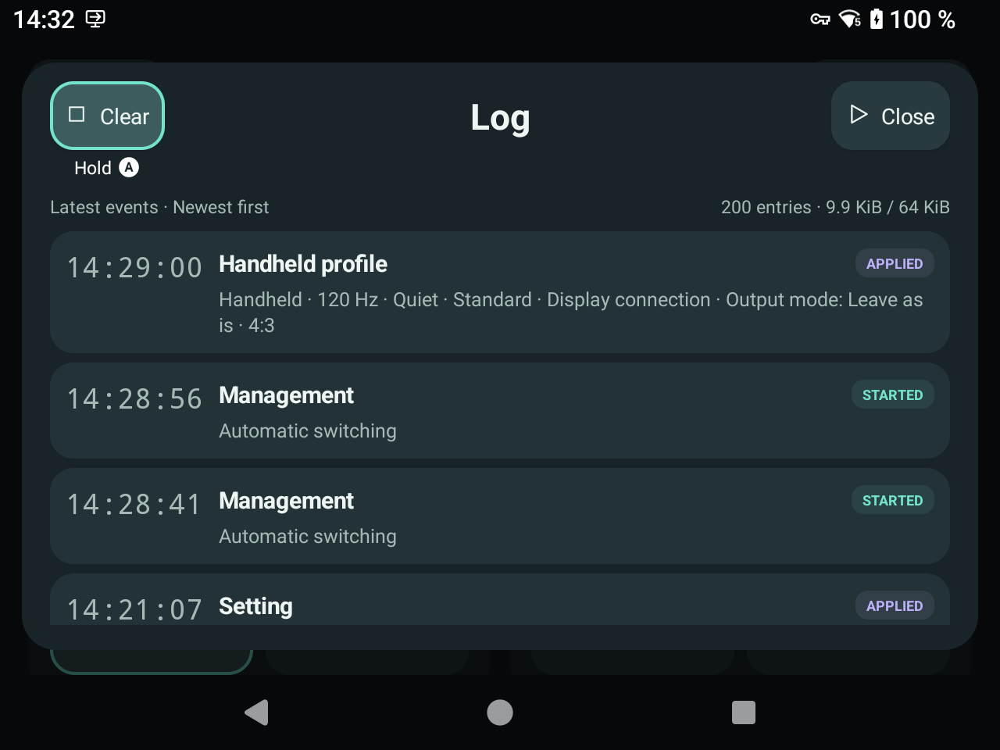
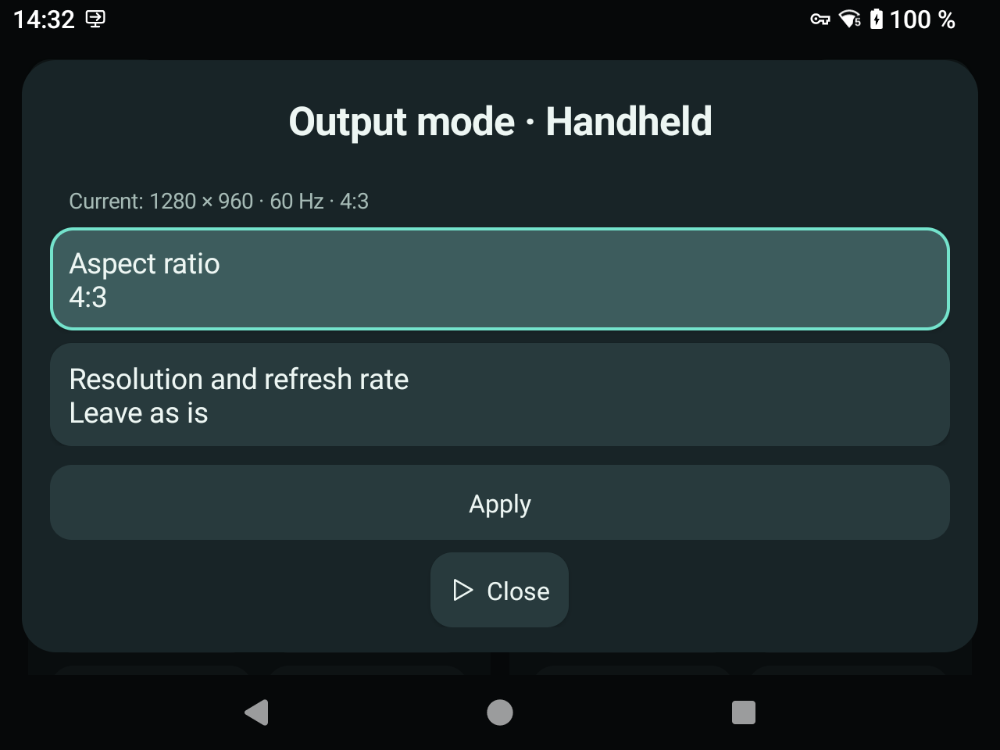
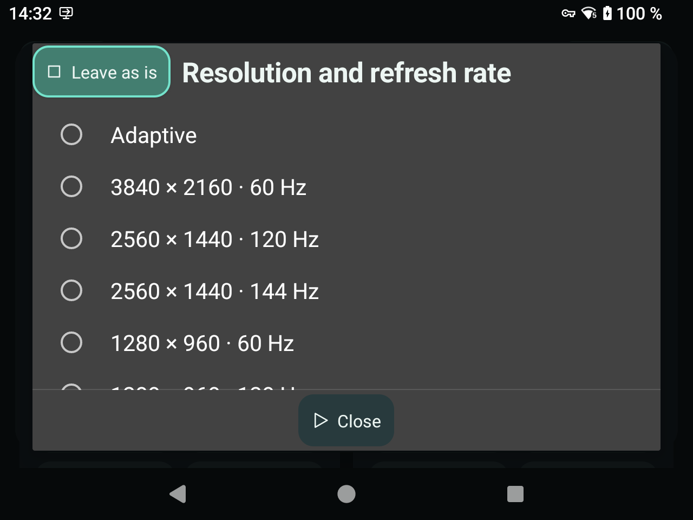

# Nova Dock

[](https://github.com/bseleng/nova-dock/actions/workflows/build.yml)
[](https://github.com/bseleng/nova-dock#compatibility)
[](LICENSE)
[](https://github.com/bseleng/nova-dock/releases)

Automatic docked and handheld profiles for **Retroid Pocket Nova**. Configure screen refresh rate, Retroid video output, cooling, performance, controller layout and bypass charging in one native Android app. Use touch or a gamepad, with English, Russian and system-language selection.

**[Download APK](https://github.com/bseleng/nova-dock/releases/tag/v0.5.0)** · **[Русская документация](docs/README.ru.md)** · **[Report an issue](https://github.com/bseleng/nova-dock/issues/new?template=bug_report.yml)**

> **Early prototype.** A physical dock/undock cycle has been confirmed by the owner on a real Nova. Configurable presets and automatic startup after real handheld and docked reboots are tested on the device. Long-term behavior and other firmware versions remain unverified.

## Default profiles

| Setting | Docked | Handheld |
|---|---|---|
| Refresh rate | **60 Hz** | **120 Hz** |
| Built-in controller | Disabled | Xbox layout |
| Fan | **Sport** | **Quiet** |
| Performance | High Performance | Standard |
| Bypass charging | **Enabled** | **Disabled** |
| Output timing | Leave as is | Leave as is |
| Output aspect ratio | **4:3** | **4:3** |

These defaults match the owner's saved Nova profiles for 0.5.0. Updating preserves existing saved choices.

## Customize each profile

Most tiles cycle their value when tapped. The output tile opens an editor with separate aspect and resolution/refresh-rate selectors. Changes save immediately after selection is confirmed. In the active card, a change also applies immediately; in the other card, it is saved for the next mode switch.

- **Refresh rate:** Leave as is → 60 Hz → 120 Hz.
- **Performance:** Standard → Performance → High Performance.
- **Fan:** cycles the presets supported by the saved performance setting and, for the active card, the current live performance setting.
- **Bypass charging:** On / Off. Defaults are **on in the dock, off in handheld mode**. Upgrades preserve saved choices.
- **Controller:** Docked cycles Off → Xbox → Retro → Off; Handheld cycles Xbox / Retro. The default dock preset remains Off.
- **Video output:** separate timing and aspect choices for each card, with Leave as is plus the stock Retroid presets.

The first row contains refresh rate and video output, the second fan and performance, and the third controller and bypass charging. All controls use the same compact two-column grid.

| Performance preset | Available fan presets |
|---|---|
| Standard | Off, Quiet, Smart, Sport, Maximum |
| Performance | Quiet, Smart, Sport, Maximum |
| High Performance | Smart, Sport, Maximum |

Changing performance preserves a compatible current fan setting, including a custom speed. An incompatible fan falls back to Smart. **Leave as is** writes neither refresh-rate setting and does not restore an earlier rate. Use the separate output control for Retroid's video-output presets.

### Temporary changes from the system quick panel

Manual changes in Retroid's quick panel remain in effect until the next dock/handheld transition or a fresh management session. Nova Dock does not repeatedly overwrite them after power or wake events. The active card shows live values; when they differ from the saved profile, a small **Сохранено:** / Saved label shows the future profile value.

An app tile saves its chosen value and applies that setting immediately, preserving other temporary choices except necessary fan/performance dependencies. The next mode switch applies the complete saved profile. Bypass charging uses Retroid's stock switch; firmware charging limits, sleep behavior and thermal control still apply.

### Gamepad controls

Use the **D-pad or left stick** to move the visible focus, **A** to activate the selected tile or action, and **B** to go back or close a dialog. On the main screen, **Start** opens Settings on the right and **Select** opens Log on the left. The pinned header marks these physical buttons with a Play triangle and a square. In dialogs, **Start** closes only the top window; **Select** runs its visible left header action, if any. The **right stick** scrolls smoothly without moving focus or selecting a value; its deflection controls scrolling speed. Focused controls have a bright rounded outline, and the screen scrolls to the selected control.

Log and Settings keep a compact **Close** button at the top right. Other dialogs keep Close in a centered bottom footer; Start or B closes the current window from any focused control. Apply/Save remains above Close in the output editor.

Clearing the journal and restoring original settings require a continuous **1.5-second hold** on the action button, using A or touch. **Clear** and **Restore** are square-marked actions at the top left of Log and Settings. Select only focuses them. A separate **Hold** hint with a filled-circle A icon appears below the button only while it has focus; reserved space keeps the next block still. The button fills while held. Releasing early, scrolling, moving focus or leaving the window resets progress; no additional confirmation window opens.

The Log button opens an event list with single-line timestamps and colored status badges. Record count and UTF-8 data size sit on the right of the newest-first row. Holding **Clear** removes only journal entries. Automatic retention keeps at most **200 complete records / 64 KiB**, without a maintenance timer. **Apply again** appears only after a profile-application error.

## Screenshots

Captured directly from Retroid Pocket Nova running **0.5.0**, at 1280 × 960 and 115% system font size. These English screenshots show the release presets; the Russian guide includes Russian screenshots.

| [Main screen](docs/images/overview.png) | [Profile tiles and gamepad focus](docs/images/profiles.png) |
|---|---|
|  |  |
| [Settings and focus-only hold hint](docs/images/settings.png) | [Log with compact statistics](docs/images/journal.png) |
|  |  |
| [Video output editor](docs/images/video-output.png) | [Retroid timing presets](docs/images/video-presets.png) |
|  |  |

Manual mode selection appears below the header when automatic switching is off.

## Settings and language

The header keeps **nova/dock** centered, with Log on the left and Settings on the right. Settings contains four switches:

- **Switch modes automatically.** Apply docked or handheld profiles when the physical video connection changes.
- **Start on boot.** Resume the last active automatic or manual session after Android starts; enabled by default.
- **Turn off device screen.** Use Retroid's **Handheld Settings → Connect TV** switch for the built-in screen while a TV is connected; enabled by default when Nova Dock first takes control.
- **Show refresh rate.** Toggle Android's developer display-frequency overlay. It reports display Hz, rather than a game's frame rate.

Choose **System default**, **Русский** or **English**. The app uses Android 13's native per-app language support, including dialogs and notifications. Changing language preserves the active session and temporary settings.

## Retroid video output

Each card's output editor has separate aspect and resolution/refresh-rate selectors, matching the two controls in **Retroid Handheld Settings → Connect TV**. The aspect picker contains two choices; the timing picker contains exactly seven stock presets. Nova Dock's **Leave as is** is a separate left header button, also available through Select. Choices edit a draft until the bottom Apply/Save action is activated with A. Start or B closes the top window; closing the editor discards its draft.

| Preset | Timing |
|---|---|
| Leave as is | Keep the current preset |
| Adaptive | Firmware selection |
| 4K | 3840 × 2160 at 60 Hz |
| 2K | 2560 × 1440 at 120 Hz |
| 2.5K | 2560 × 1440 at 144 Hz |
| 960P / 1080P | 60, 120 or 240 Hz |

The last three timings use **1280 × 960** for **4:3**, or **1920 × 1080** for **16:9**. These are the manufacturer's choices, not a list filtered by a connected display's capabilities. Actual output depends on the display, dock and firmware.

As in Retroid's menu, aspect ratio also changes the logical size of the main display. Nova Dock saves an output choice for each mode and applies it with that mode's other settings. For example, save 16:9 for Docked and 4:3 for Handheld to switch automatically on connection and disconnection. Both initially use 4:3 and Leave as is.

An active-card edit applies immediately, making it possible to change the view while playing. An inactive-card edit is saved for the next transition. Leave as is preserves the current preset; when aspect changes, recognized 960P/1080P timings follow Retroid's matching resolution family. The original output configuration is captured before the first change and remains restorable.

Nova Dock reads the system configuration directly. Retroid's own menu keeps its selection in private app preferences, so its label can retain the last choice made inside that menu after Nova Dock changes the output. The screen-off switch uses a shared system setting and stays synchronized.

## Getting started

1. Download and install the APK from [Releases](https://github.com/bseleng/nova-dock/releases/tag/v0.5.0).
2. Open **Nova Dock**, choose your presets, then enable **Switch modes automatically** in Settings, or select a mode manually.
3. Allow notifications so the current profile and stop action remain accessible.
4. Connect or disconnect your external display. Allow about **5 seconds** for the connection to settle and the profile to apply.

No root installation, Shizuku or ADB permission grant is required on the tested stock firmware. A computer is not needed for normal operation.

Turning automatic switching off keeps the current mode and values. Manual mode controls appear below the header. The app can also restore the settings saved before its first change. Restore those settings before uninstalling if you want the original device configuration back.

## Automatic and manual modes

Settings includes two session switches:

- **Переключать режимы автоматически** / Switch modes automatically: watches the external display and applies the saved docked or handheld profile when the connection changes.
- **Запускать после загрузки** / Start on boot: resumes the last active management session after Android finishes booting.

With automatic switching off, **Docked** and **Handheld** buttons appear below the header. Choosing a different mode applies its complete saved profile, independently of the display connection. Display and power events do not change the manual mode. Selecting the already active mode leaves temporary changes intact.

Tiles in the active manual card apply changes immediately, just as in automatic mode. The active badge identifies the currently selected mode. Normal parameter summaries are omitted from the top panel; errors, waiting and recovery appear there only when needed.

## Startup after reboot

**Start on boot** is enabled by default and works with either automatic or manual management. Turning it off leaves the current session running but prevents startup after the next reboot. Opening the app manually resumes a session that has not been explicitly stopped.

The notification's Stop action stops management and leaves current device values in place. Restoring original settings also stops management. After either action, choose a manual mode or enable automatic switching to begin a new session. An APK update resumes an active session independently of the boot switch.

Real automatic-mode reboots with and without an external display were verified on 0.3.0 without opening Nova Dock. The startup option was also checked on 0.4.0 with real on/off reboots. See compatibility notes for the tested firmware and limits.

## How it works

- Reads the physical DisplayPort connection, with Retroid properties and Android presentation displays as fallbacks.
- Uses display callbacks and firmware events, plus a lightweight periodic check.
- Waits for a stable connection and ignores unknown sensor states.
- Applies the same system settings used by Retroid's quick settings tiles.
- Settles Retroid performance/charging changes before restoring a compatible fan during an explicit application.
- Applies app tile edits through one serialized worker, coalescing repeated changes and acknowledging the latest request.
- Leaves subsequent manual quick-panel values alone until the next mode switch.
- Extends the saved original-settings snapshot only for newly managed settings, preserving older original values.
- Runs a foreground service with a notification and supports startup after boot when enabled.
- Has no internet permission, analytics, game-file access or emulator configuration changes.

Retroid's stock **`PServerBinder`** service executes commands with its own privileged identity. Nova Dock does not install root access. This is a vendor-specific interface; an OTA can change its availability. The adapter allows only the managed system keys, known output properties and aspect presets, and the fixed SurfaceFlinger refresh-overlay operation. It exposes no external command-execution endpoint.

<details>
<summary>System settings used</summary>

```text
min_refresh_rate
peak_refresh_rate
performance_mode
fan_mode
fan_speed
temp_abxy_layout_mode
no_create_gamepad_button_layout
flip_button_layout
is_charging_separation
close_screen_when_output_video
```

The first nine keys belong to the profiles; `close_screen_when_output_video` is Retroid's global built-in-screen switch. On the tested firmware, Standard is `performance_mode=0`, High Performance is `2`, Quiet is `fan_mode=1`, and maximum custom fan speed is `fan_mode=6` with `fan_speed=35000`. Bypass charging is `is_charging_separation=1`; normal charging is `0`. Thermal protection is not modified.

Video output uses the stock `persist.vendor.dp.select`, `persist.vendor.dp.hdisplay`, `persist.vendor.dp.vdisplay` and `persist.vendor.dp.fps` properties. Aspect changes use WindowManager with the same sizes as Retroid. The developer overlay uses SurfaceFlinger transaction 1034. Output profiles apply on mode transitions or explicit active edits; global screen/overlay controls apply explicitly. None are continuously reasserted by polling.

</details>

## Compatibility

| Device | Android | Firmware | Status |
|---|---|---|---|
| Retroid Pocket Nova | 13 / API 33 | `RPN_V1.0.0.436` | Physical dock/undock cycle confirmed; configurable profile checks passed |

Measured on the device:

- **Dock profile:** `60.000004 Hz`, fan PWM `35000`, no gamepad exposed through `InputDevice`.
- **Handheld profile:** `120.00001 Hz`, Quiet PWM `12000`, `Xbox Wireless Controller` restored.
- All eight setting values matched the intended profiles; the self-test restored the previous values afterward.
- Foreground automation started and applied the handheld profile without an external display.

The owner completed a real TV connection/disconnection cycle with the initial prototype and reported expected operation. The transition log confirmed both modes, with no repeated profile application during the dock session.

In 0.2.0, on-device tests also verified Smart/Performance while leaving frequency unchanged, and Sport/Performance/Retro at 60 Hz. A simulated charging-status change reproduced the stock Smart override; the saved Quiet preset was restored in about 1.7 seconds without changing the controller device ID or refresh settings.

In 0.3.0, the stock bypass switch and the charging driver were verified in both directions: enabled produced `usb_charge_now=0`, disabled produced `1`. Tests covered the opposite user choices, saving from the real UI, upgrading an older original-settings snapshot and restoring all nine previous setting values. Existing profile choices were preserved.

A real handheld reboot on 0.3.0 also passed: `BOOT_COMPLETED` started the foreground service without opening the activity; the saved 120 Hz / Xbox / Quiet / Standard / normal-charging profile was applied about three seconds after service startup. The charging driver reported `usb_charge_now=1`. Saved profile choices and original-setting snapshots were unchanged.

The owner then rebooted with the external display connected and returned the Nova to the computer. The new boot and foreground-service state confirmed `BOOT_COMPLETED` startup. The transition log recorded the saved 60 Hz / Sport dock profile about two seconds after service startup, then the handheld profile when the display was disconnected. No profile errors were recorded; saved choices and original-setting snapshots were preserved.

In 0.4.0, device checks passed for live manual overrides, applying one app tile without resetting other temporary values, rapid coalesced changes, compatible custom fan speed, and the fan/performance dependency order. Both complete profiles and custom presets passed again, including charging-driver checks and exact restoration of all nine settings. Android gamepad D-pad/A/B events were tested on the Nova for navigation, value changes and dialog handling; external controller models have not been individually certified.

Two further real reboots verified the startup option: off kept the foreground service stopped, while on started it through `BOOT_COMPLETED` and applied the handheld profile without opening the app. Manual opening resumed a previously enabled mode. Existing profiles and original-setting snapshots were preserved.

Manual-mode checks on 0.4.0 verified that turning automatic switching off preserves runtime overrides, manual Docked works without an external display, selecting the same mode does not reset temporary values, and active tiles apply immediately. Rapid mode changes settled at the last selection. Restoring original settings stopped management; reopening left those values unchanged. The complete profile self-test also restored the entire manual-session preference snapshot.

Two real reboots then checked manual Docked mode: startup off kept the service stopped until the app was opened; startup on resumed the manual dock profile through `BOOT_COMPLETED`, without opening Nova Dock or attaching an external display. Bypass charging was enabled in the driver. The user's saved profiles, startup choice and original-setting snapshot were preserved.

The 0.5.0 device checks verified the native screen-off switch, refresh overlay, output presets and exact restoration. Separate saved output profiles applied through manual mode changes; active output edits preserved the other nine values. D-pad/A/B and Start/Select navigation, journal scrolling and Clear cancellation, RU/EN/system language, and a 115% font scale passed. Language changes preserved a temporary custom fan setting. The owner deferred the new external-display video-output and frame-pacing check to the next test cycle; 0.5.0 does not claim that check passed.

The main and modal headers passed 68 on-device layout cases in English/Russian at 100%/115% font scales. Window tests verified fixed Close buttons (top right in Log/Settings, centered below other dialogs), the one-row journal statistics, top-window closure, left actions and held/cancelled/orphan button releases. Real Clear/Restore controls received only short, non-destructive input. A separate counter-only dialog verified complete A/touch holds, visible intermediate progress, one-shot completion, fresh presses and cancellation on scrolling, focus/window changes, early release and multitouch. Saved choices and native settings were unchanged after these checks.

The follow-up device run read back all 14 stock aspect/preset combinations, checked 1,660 tile presentations without clipping or height changes, and injected right-stick events into every scrollable window. Direction, neutral, dead zone, speed and unchanged focus/selection passed. Final RU/EN UI checks preserved the initial hardware values and saved profiles.

The editable dock-controller follow-up verified left-stick X/Y and D-pad navigation to that tile, A cycling Off/Xbox/Retro while inactive without changing native values, active controller-only writes, storage upgrade fallback, and 1,708 stable tile presentations. Original settings and key presence were restored after testing.

Long-term background survival, objective TV frame-pacing measurements and each emulator's controller/session handling remain unverified. The app currently accepts only Nova on Android 13.

## Build

Requires **Python 3.9+**, **JDK 17**, **Android SDK Platform 35** and **Build Tools 35.0.0**. macOS and Linux are supported. No Gradle or third-party libraries are used.

```sh
git clone https://github.com/bseleng/nova-dock.git
cd nova-dock
python3 build.py
```

Output: `dist/Nova-Dock-0.5.0.apk`. The build verifies the APK signature and runs eleven test suites covering connection state, profile changes, session control, UTF-8 journal limits, global commands, output rollback, saved output specifications, analog-scroll timing, controller presets, window-owned button presses and hold-to-confirm timing.

Check all twelve tile layouts on a connected device, including RU/EN, 100/115% font sizes and short/long labels:

```sh
python3 tools/check_tiles.py --serial DEVICE_SERIAL
```

The check uses isolated resource configurations and reopens the app afterward.

Optional variables: `ANDROID_SDK_ROOT` / `ANDROID_HOME`, `NOVA_JAVA_HOME` / `JAVA_HOME`, `NOVA_BUILD_DIR`, `NOVA_APK_PATH`.

A local development signing key is created under `keys/` and excluded from Git. Keep it to sign future compatible updates. Builds signed with a different key cannot update an existing installation. Published APKs use the maintainer's retained local key; CI only checks that the project builds.

This pre-release is a debuggable development build with on-device instrumentation. It is intended for testing rather than store distribution.

## On-device checks

Read-only diagnostic:

```sh
adb shell am instrument -w local.nova.dock/.DeviceCheck
```

Test both profiles **with the external display disconnected**. This temporarily changes the nine settings and restores the previous values afterward:

```sh
adb shell am instrument -w -e profiles true local.nova.dock/.DeviceCheck
```

To also test non-default profiles and **Leave as is**:

```sh
adb shell am instrument -w -e profiles true -e customProfiles true local.nova.dock/.DeviceCheck
```

Instrumentation restarts the application process. Reopen Nova Dock afterward to resume an active automatic or manual session:

```sh
adb shell am start -n local.nova.dock/.MainActivity
```

## Contributing

See [CONTRIBUTING.md](CONTRIBUTING.md). Reports with firmware version, dock/TV model and transition logs are useful while compatibility is being validated.

The vendor interface was investigated on the owner's device; [Hugminn](https://github.com/Ninte86hl/Hugminn) also documents the same stock Retroid service. No vendor APKs, decompiled vendor sources, private device logs or signing keys are included in this repository.

## License

[MIT](LICENSE) — Copyright © 2026 Bogdan Selenginskiy.
