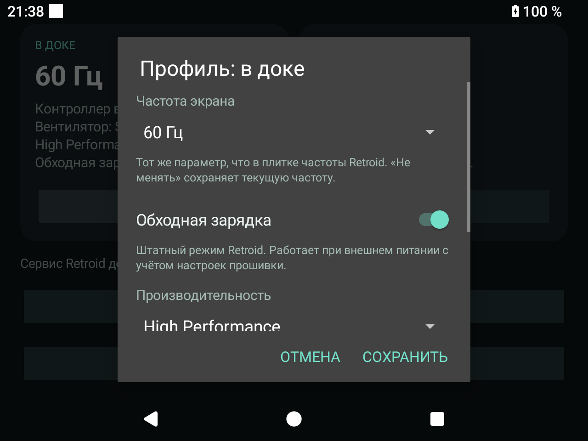

# Nova Dock

Локальный прототип для **Retroid Pocket Nova, Android 13**. Подготовлен по компонентам прошивки `RPN_V1.0.0.436_20260722_083524_user`.

Настройки по умолчанию:

| Настройка | Внешний дисплей подключён | Внешний дисплей отключён |
|---|---|---|
| Частота | 60 Гц | 120 Гц |
| Контроллер | Выключен | Xbox |
| Вентилятор | Максимум, Custom 35000 | Quiet |
| Производительность | High Performance | Standard |
| Обходная зарядка | Включена | Выключена |

Приложение использует те же системные настройки, что штатные плитки Retroid, через встроенный сервис прошивки `PServerBinder`. Штатное отключение подсветки при выводе на ТВ настраивается в Retroid; Nova Dock его не меняет. Получать root, устанавливать Shizuku или выдавать системные разрешения через ADB не требуется. В манифесте отсутствуют разрешения на интернет и `WRITE_SECURE_SETTINGS`.

## Установка

Установить APK, открыть **Nova Dock** и включить **Автоматический режим**. На Android 13 разрешить уведомления: в постоянном уведомлении видны режим и кнопка остановки.

```sh
adb install -r Nova-Dock-0.3.0.apk
```

Остановка автоматики возвращает портативный профиль. Внизу экрана также есть восстановление исходных настроек, сохранённых перед первым применением профиля. Перед удалением приложения остановить автоматику или восстановить исходные настройки.

## Автозапуск после перезагрузки

Достаточно один раз включить автоматический режим. После завершения загрузки Android Nova Dock сама запускает фоновую службу и применяет сохранённый профиль по текущему подключению внешнего дисплея. Открывать приложение после каждой перезагрузки не требуется. Если автоматика была выключена, обработчик загрузки оставляет её выключенной.

На версии 0.3.0 проверена реальная перезагрузка без внешнего дисплея и без открытия Nova Dock: система запустила `BootReceiver` по `BOOT_COMPLETED`, служба применила портативный профиль, на экране остался лаунчер. Настройки профилей и снимок исходных значений сохранились. Прошивка и ограничения проверки указаны ниже.

## Настройка профилей

Кнопка **«Настроить»** есть в каждой карточке. Для дока и портативного режима отдельно выбираются:

- Частота: **«Не менять»**, 60 Гц или 120 Гц. «Не менять» оставляет текущие системные параметры без записи и не восстанавливает предыдущую частоту.
- Производительность: Standard, Performance или High Performance.
- **Обходная зарядка:** отдельный переключатель в каждом профиле. По умолчанию включена в доке и выключена в портативном режиме.
- Вентилятор: выключен, Quiet, Smart, Sport или максимум. Как в шторке Retroid, в Performance нельзя выключить вентилятор, а в High Performance недоступны выключение и Quiet.
- Для портативного режима — раскладка встроенного контроллера **Xbox или Retro**. В доке встроенный контроллер отключается.

Изменения сохраняются между запусками. Если автоматика включена, изменение активного профиля применяется сразу. По умолчанию остаются исходные 60/120 Гц, максимум/Quiet и Xbox. Частота управляет тем же параметром, что штатная плитка Retroid; режим самого внешнего монитора выбирает прошивка.

Обходная зарядка использует штатный режим Retroid. Ограничения зарядки и поведение во сне остаются под управлением прошивки. Обновление добавляет новый параметр, сохраняя остальные настройки профилей и ранее сохранённые исходные значения.

## Скриншоты с устройства

Сняты непосредственно с Retroid Pocket Nova, версия приложения 0.3.0, разрешение 1280 × 960. По ссылке в подписи открывается исходное изображение.

| [Главный экран](images/overview.png) | [Карточки профилей](images/profiles.png) |
|---|---|
|  |  |
| [Настройка дока](images/dock-profile.png) | [Настройка портативного режима](images/handheld-profile.png) |
|  |  |

## Технические детали

- Определение видеовыхода: `/sys/class/drm/card0-DP-1/status`; резерв — `sys.dp.isconnect`, `persist.sys.hdmiisconnect` и наличие presentation-дисплея. Недоступное состояние не считается отключением.
- `DisplayManager` и события Retroid ускоряют проверку; повторная проверка выполняется примерно каждые 1,2 с без постоянного WakeLock.
- Устойчивое подключение 1,2 с, отключение 2,2 с. Это подавляет краткие обрывы сигнала.
- Фоновая foreground-служба, `START_STICKY`, запуск по `BOOT_COMPLETED` и после обновления APK, если автоматика включена. Реальная перезагрузка в портативном режиме проверена; загрузка в доке и устойчивость к фирменному убийству фоновых процессов пока не проверены.
- Смена производительности может переписать режим вентилятора. Nova Dock повторно задаёт вентилятор после задержки и проверяет весь профиль.
- После событий питания и пробуждения повторно проверяются вентилятор и обходная зарядка. Прошивке даётся время завершить изменение зарядки, затем восстанавливается выбранный вентилятор без переподключения контроллера.
- `PServerBinder` — привилегированный сервис производителя, выполняющий команды от root. Приложение отправляет ему только чтение `id` для диагностики и операции `settings put/delete system` по девяти ключам ниже. Имена проверяются по фиксированному списку, значения — по числовому формату. В приложении нет внешнего IPC-интерфейса выполнения команд. Это не публичный Android API, совместимость после OTA требует повторной проверки.
- Сеть, пользовательские файлы, игры и настройки эмуляторов не используются.
- Прототип не обещает сохранение игрового сеанса или привязок внешнего геймпада во всех эмуляторах; это зависит от конкретного приложения и режима вывода Retroid.

Изменяемые `Settings.System`:

```text
min_refresh_rate
peak_refresh_rate
performance_mode
fan_mode
fan_speed
temp_abxy_layout_mode
no_create_gamepad_button_layout
flip_button_layout
is_charging_separation
```

`performance_mode=0` называется **Standard** в интерфейсе этой прошивки, хотя внутренний enum использует имя NORMAL. Максимальная производительность — `2`. Quiet — `fan_mode=1`; максимальная пользовательская скорость — `fan_mode=6`, `fan_speed=35000`. Это верхняя граница пользовательского ползунка для ветки устройств Nova/Mini; тепловая защита прошивки не изменяется.

## Сборка и проверки

Нужны Python 3, JDK 17, Android SDK Platform 35 и Build Tools 35.0.0. Загрузки зависимостей не требуются.

```sh
python3 build.py
```

Пути можно задать через `ANDROID_SDK_ROOT` / `ANDROID_HOME`, `NOVA_JAVA_HOME` / `JAVA_HOME`, `NOVA_BUILD_DIR`, `NOVA_APK_PATH`. APK появляется в `dist/Nova-Dock-0.3.0.apk`. Поддерживаются macOS и Linux. Локальный ключ подписи создаётся в `keys/`; сохраните его для установки будущих обновлений без переустановки. Это ключ для разработки, пароль `android`. APK отладочный, не предназначен для публикации в магазине. Ключ хранится отдельно в локальной папке исходников и не включается в Git. Сборка с другим ключом не установится поверх опубликованного APK без удаления предыдущей версии.

Сборка проверяет подпись APK и запускает тесты подавления кратких обрывов/неопределённого состояния. Чтение состояния устройства:

```sh
adb shell am instrument -w local.nova.dock/.DeviceCheck
```

Проверка профилей временно применяет оба профиля и восстанавливает исходные настройки. Выполнять при отключённом внешнем дисплее:

```sh
adb shell am instrument -w -e profiles true local.nova.dock/.DeviceCheck
```

Исходники системных APK, снятых для диагностики, в этот проект не включены. Реализация написана отдельно по проверенному порядку и значениям настроек прошивки.

## Проверено на устройстве 24.11.2026

- Установка и открытие интерфейса на Nova, Android 13, сборка `RPN_V1.0.0.436`.
- Работа штатного `PServerBinder` из обычного процесса приложения. `WRITE_SECURE_SETTINGS` отозван и отсутствует в установленном манифесте.
- Чтение реального состояния DisplayPort приложением.
- Док-профиль: фактическая частота `60.000004` Гц, PWM вентилятора `35000`, игровые контроллеры отсутствуют в `InputDevice`.
- Портативный профиль: фактическая частота `120.00001` Гц, Quiet, PWM `12000`, появляется `Xbox Wireless Controller`.
- Проверено соответствие всех восьми настроек обоим профилям. После самопроверки исходные настройки восстановлены.
- Запущена foreground-служба и включена автоматика; без внешнего дисплея она применила портативный профиль.
- Пройдены тесты короткого обрыва, переподключения и неопределённого состояния датчика; подпись APK проверена.

Владелец проверил физическое подключение телевизора и отключение от него: по первому впечатлению всё работает. Журнал подтвердил оба перехода, без повторных применений профиля в течение сеанса.

Для 0.2.0 проверены пользовательский док-профиль Smart/Performance без изменения частоты и портативный Sport/Performance/Retro на 60 Гц. Восстановление выбранного Quiet после штатного Smart при смене статуса зарядки заняло около 1,7 с; частота и идентификатор контроллера не изменились. Исходные значения после диагностических тестов восстановлены.

Для 0.3.0 проверены включение и выключение штатного переключателя обходной зарядки и состояние драйвера: включённому режиму соответствует `usb_charge_now=0`, выключенному — `1`. Проверены обратные пользовательские значения, сохранение через интерфейс, обновление ранее сохранённого снимка исходных настроек и точное восстановление всех девяти значений. Прежние настройки профилей сохранены.

Реальная перезагрузка на 0.3.0 без внешнего дисплея также прошла проверку: `BOOT_COMPLETED` запустил foreground-службу без открытия интерфейса. Примерно через три секунды после старта службы применился сохранённый портативный профиль: 120 Гц, Xbox, Quiet, Standard, обычная зарядка (`usb_charge_now=1`). Настройки профилей и снимок исходных значений не изменились.

Перезагрузка с подключённым внешним дисплеем, длительная работа в фоне, инструментальное измерение плавности ТВ и поведение каждого эмулятора остаются непроверенными.

Дополнительная проверка пользовательских профилей:

```sh
adb shell am instrument -w -e profiles true -e customProfiles true local.nova.dock/.DeviceCheck
adb shell am start -n local.nova.dock/.MainActivity
```

Инструментальный тест перезапускает процесс приложения. После любого такого теста откройте Nova Dock: включённая автоматика возобновится.
