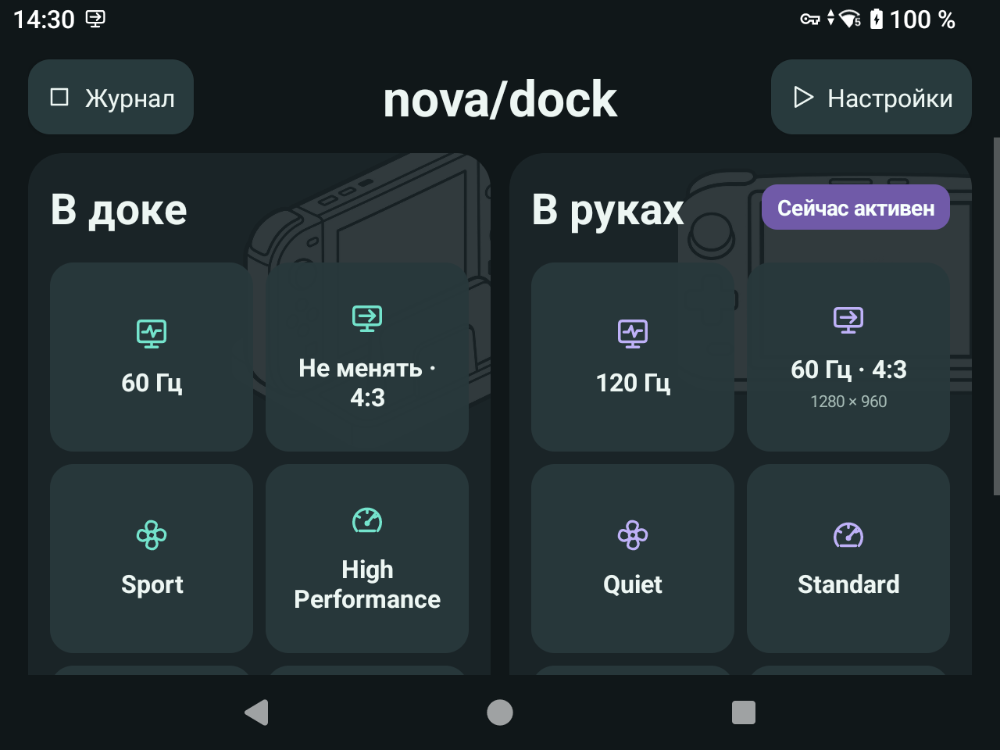
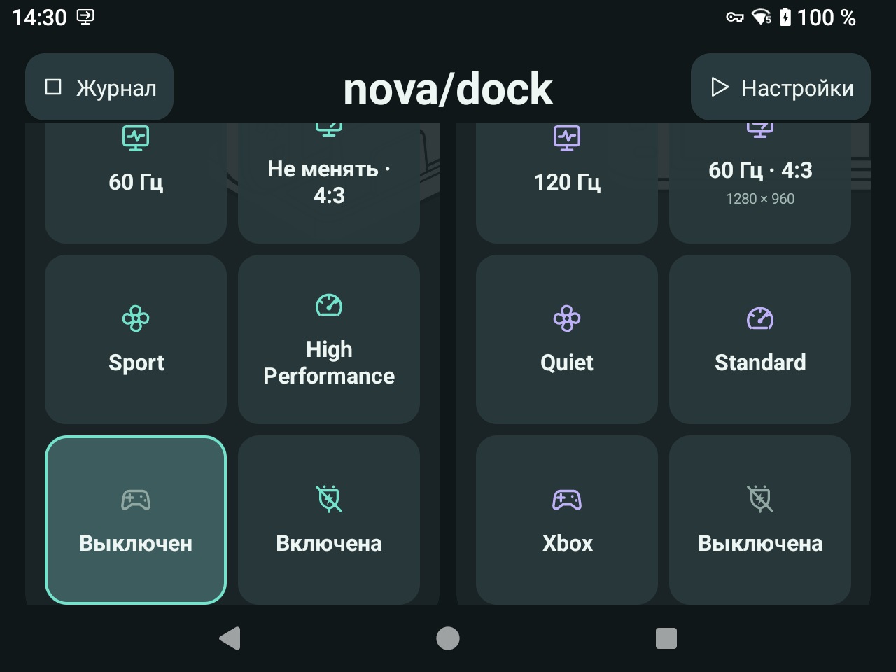
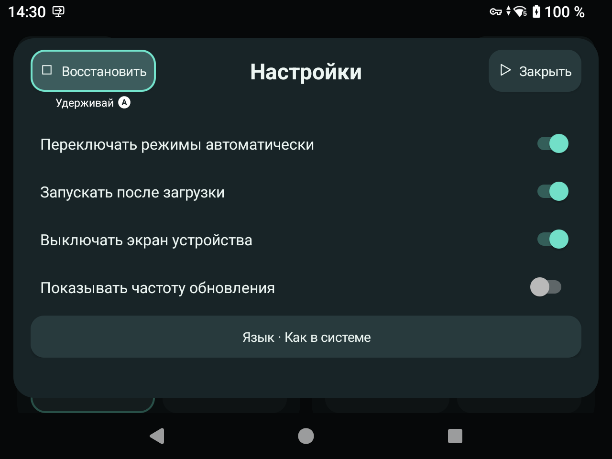
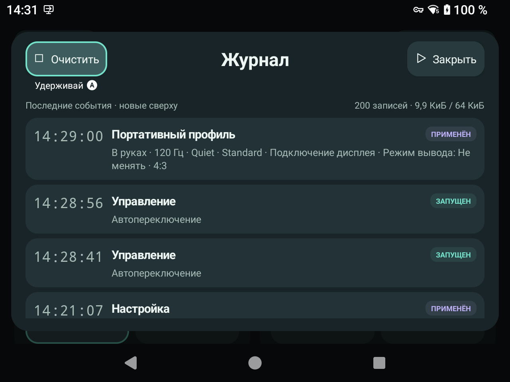
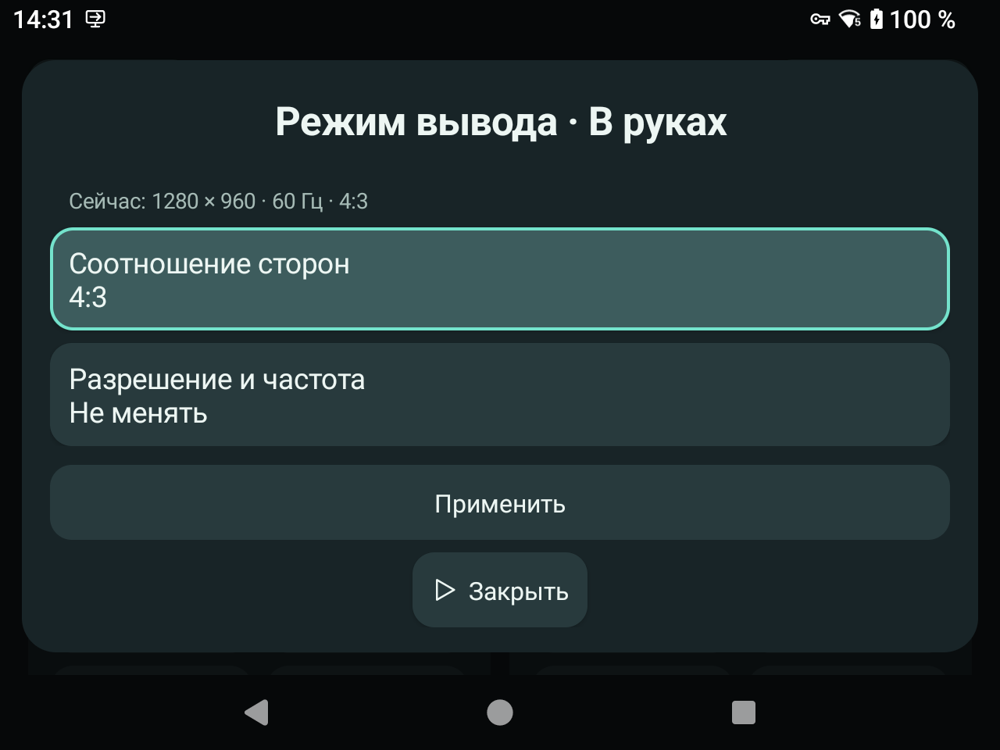
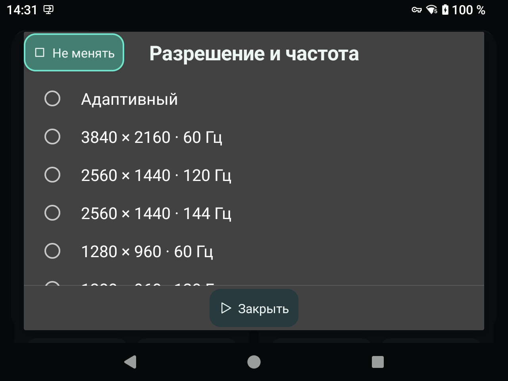

# Nova Dock

Автоматические профили дока и портативного режима для **Retroid Pocket Nova, Android 13**. Частота экрана, видеовыход Retroid, охлаждение, производительность, контроллер и обходная зарядка настраиваются в одном приложении с управлением касанием или геймпадом. Доступны русский, английский и язык системы. Проверенная прошивка — `RPN_V1.0.0.436_20260722_083524_user`.

Настройки по умолчанию:

| Настройка | В доке | В руках |
|---|---|---|
| Частота | 60 Гц | 120 Гц |
| Контроллер | Выключен | Xbox |
| Вентилятор | **Sport** | **Quiet** |
| Производительность | High Performance | Standard |
| Обходная зарядка | Включена | Выключена |
| Режим вывода | Не менять | Не менять |
| Пропорции вывода | **4:3** | **4:3** |

Эти значения совпадают с сохранёнными профилями владельца для 0.5.0. Обновление сохраняет ранее выбранные настройки.

Приложение использует штатные настройки Retroid через встроенный сервис прошивки `PServerBinder`: плитки шторки и параметры **Handheld Settings → Connect TV**. Получать root, устанавливать Shizuku или выдавать системные разрешения через ADB не требуется. В манифесте отсутствуют разрешения на интернет и `WRITE_SECURE_SETTINGS`.

## Установка

Установить APK, открыть **Nova Dock** и включить **«Переключать режимы автоматически»** в настройках либо выбрать режим вручную. На Android 13 разрешить уведомления: в постоянном уведомлении видны режим и кнопка остановки.

```sh
adb install -r Nova-Dock-0.5.0.apk
```

Отключение автопереключения сохраняет текущий режим и значения. Сверху слева в настройках доступно восстановление конфигурации, сохранённой перед первым применением профиля; действие требует удержания. Перед удалением приложения используйте восстановление, если хотите вернуть исходную конфигурацию устройства.

## Автоматическое и ручное переключение

Окно «Настройки» содержит два переключателя управления:

- **«Переключать режимы автоматически»** — следить за внешним дисплеем и применять сохранённый профиль при подключении или отключении.
- **«Запускать после загрузки»** — возобновлять последний активный способ управления после загрузки Android.

Когда автопереключение выключено, под заголовком появляются кнопки **«В доке»** / **«В руках»**. Выбор другого режима применяет весь его сохранённый профиль независимо от подключённого дисплея. Подключение кабеля и события питания не меняют ручной режим. Повторное нажатие уже активного режима сохраняет временные изменения.

Плитки активной карточки работают сразу и в ручном режиме. Текущий выбор отмечен бейджем. Дублирующих обычных сводок в верхнем блоке нет; ошибки, ожидание и действие повтора появляются только при необходимости.

## Настройки и язык

Название **nova/dock** расположено по центру; «Журнал» — слева, «Настройки» — справа. В настройках собраны четыре переключателя: автопереключение, автозапуск, **«Выключать экран устройства»** и **«Показывать частоту обновления»**.

Выключение экрана использует тот же параметр, что **Retroid Handheld Settings → Connect TV**. Он включается по умолчанию при первом начале управления; последующие явные изменения сохраняются. Индикатор из настроек разработчика показывает частоту обновления дисплея в Гц, а не частоту кадров игры.

Язык выбирается из **«Как в системе»**, **«Русский»**, **«English»**. Используется штатная смена языка приложения в Android 13; интерфейс, диалоги и уведомления переведены. Выбор языка сохраняет текущую сессию и временные настройки.

## Видеовыход Retroid

В плитке видеовыхода отдельно выбираются пропорции и разрешение/частота, как в двух пунктах **Handheld Settings → Connect TV**. В первом списке два варианта, во втором — ровно семь заводских пресетов. **«Не менять»** находится слева в шапке и вызывается Select. Выбор остаётся черновиком до нижней кнопки «Применить/Сохранить», доступной через A. Start или B закрывает только верхнее окно; закрытие редактора отбрасывает черновик.

| Режим | Разрешение и частота |
|---|---|
| Не менять | Сохранить текущий пресет |
| Adaptive | Выбор прошивки |
| 4K | 3840 × 2160, 60 Гц |
| 2K | 2560 × 1440, 120 Гц |
| 2.5K | 2560 × 1440, 144 Гц |
| 960P / 1080P | 60, 120 или 240 Гц |

Последние три варианта используют **1280 × 960** при **4:3** или **1920 × 1080** при **16:9**. Это набор производителя; фактический вывод зависит от дисплея, док-станции и прошивки.

Как и в меню Retroid, выбор пропорций меняет логический размер основного дисплея. Nova Dock сохраняет выбор отдельно для каждого режима и применяет его вместе с остальными настройками. Например, можно выбрать 16:9 в доке и 4:3 в руках для автоматического переключения при подключении и отключении. Первоначально в обоих режимах выбраны 4:3 и «Не менять».

Изменение активной карточки применяется сразу; неактивной — сохраняется до следующего перехода. «Не менять» сохраняет текущий пресет; при смене пропорций распознанные варианты 960P/1080P перестраиваются в соответствующий формат, как у Retroid. Исходная конфигурация сохраняется перед первым изменением и остаётся доступной для восстановления.

Nova Dock читает системную конфигурацию напрямую. Меню Retroid хранит выбранный пункт отдельно в своих приватных настройках, поэтому его подпись может оставаться прежней после изменения видеовыхода через Nova Dock. Переключатель выключения экрана использует общую системную настройку и синхронизируется со штатным меню.

## Автозапуск после перезагрузки

**«Запускать после загрузки»** включён по умолчанию и действует как для автоматического, так и для ручного управления. Его выключение сохраняет текущую сессию, но запрещает запуск после следующей перезагрузки. Ручное открытие приложения возобновляет сессию, если она не была явно остановлена.

Кнопка остановки в уведомлении прекращает управление, оставляя текущие значения устройства. Восстановление исходных настроек также останавливает управление. Чтобы начать новую сессию, выберите ручной режим или включите автопереключение. Обновление APK возобновляет активную сессию независимо от настройки автозапуска.

На 0.3.0 проверены реальные автоматические перезагрузки с внешним дисплеем и без него, без открытия Nova Dock. На 0.4.0 также проверена настройка запуска реальными перезагрузками с включённым и выключенным автозапуском. Прошивка и ограничения проверки указаны ниже.

## Настройка плитками

Первый ряд — частота и вывод, второй — вентилятор и производительность, третий — контроллер и обходная зарядка. Используется одинаковая компактная сетка из двух колонок.

Нажатие на плитку переключает значение по кругу и сразу сохраняет его. В активной карточке выбранная настройка также применяется сразу; в другой — сохраняется до переключения режима. Модальных редакторов и кнопок «Настроить» / «Сохранить» больше нет.

- **Частота:** «Не менять» → 60 Гц → 120 Гц. «Не менять» не записывает параметры частоты и не восстанавливает прежнее значение.
- **Производительность:** Standard → Performance → High Performance.
- **Вентилятор:** выключен, Quiet, Smart, Sport или максимум в зависимости от производительности. В Performance нельзя выключить вентилятор, в High Performance доступны Smart, Sport и максимум. Для активной карточки учитывается и фактическая производительность.
- **Обходная зарядка:** включена / выключена. По умолчанию **включена в доке и выключена в портативном режиме**; обновление сохраняет прежние пользовательские значения.
- **Контроллер:** в доке «Выключен → Xbox → Retro → Выключен»; в руках Xbox / Retro. По умолчанию в доке контроллер остаётся выключенным.

При смене производительности совместимый текущий режим вентилятора сохраняется, включая пользовательскую скорость. Если он несовместим, используется Smart. Для режима самого внешнего дисплея служит отдельная плитка видеовыхода.

### Ручные изменения в шторке

Выбранные в штатной шторке значения действуют до следующего перехода док / портативный режим или новой сессии управления. Приложение больше не возвращает их периодически после событий питания и пробуждения. В активной карточке видны фактические значения; подпись **«Сохранено: …»** показывает значение профиля, если оно отличается.

Нажатие плитки приложения сохраняет и применяет выбранную настройку, сохраняя остальные временные значения, кроме необходимых зависимостей вентилятора и производительности. При следующей смене режима применяется весь сохранённый профиль.

Обходная зарядка использует штатный режим Retroid. Ограничения зарядки, работа во сне и тепловая защита остаются под управлением прошивки. Например, обходную зарядку можно временно выключить в шторке, чтобы зарядить Nova в доке; при следующем переходе в док вернётся сохранённое значение.

### Управление геймпадом

**Крестовина или левый стик** перемещают выделение, **A** нажимает выбранную плитку или действие, **B** возвращает назад и закрывает диалоги. На главном экране **Start** открывает настройки справа, **Select** — журнал слева. Закреплённая шапка обозначает эти аппаратные кнопки треугольником Play и квадратом. В окнах **Start** закрывает только верхнее окно, а **Select** выполняет видимое левое действие шапки, если оно есть. **Правый стик** плавно прокручивает содержимое без смены фокуса или выбора значения; скорость зависит от отклонения. Фокус выделяется яркой скруглённой рамкой; экран прокручивается к выбранному элементу.

В журнале и настройках компактная кнопка «Закрыть» находится сверху справа. В остальных окнах она остаётся снизу по центру. Start или B закрывает текущее окно из любого положения фокуса. В редакторе видеовыхода «Применить/Сохранить» остаётся выше «Закрыть».

Очистка журнала и восстановление исходных настроек требуют непрерывного удержания кнопки **1,5 секунды** — через A или касанием. «Очистить» и «Восстановить» со значком квадрата находятся сверху слева в журнале и настройках. Select только переводит на них фокус. Отдельная подсказка «Удерживай» с круглым значком A появляется под кнопкой только при фокусе; зарезервированное место удерживает следующий блок на месте. Кнопка заполняется по мере удержания. Раннее отпускание, прокрутка, смена фокуса или закрытие окна сбрасывает прогресс; дополнительного подтверждения нет.

**«Журнал»** открывает список событий: время в одну строку, промежутки между записями и цветные статусы. Число записей и объём данных UTF-8 показаны справа в строке порядка событий. Удержание «Очистить» удаляет только журнал. Автоограничение оставляет до **200 целых записей / 64 КиБ**, без фонового таймера очистки. Действие **«Применить снова»** появляется только после ошибки применения профиля.

## Скриншоты с устройства

Сняты непосредственно с Retroid Pocket Nova, **версия 0.5.0**, разрешение 1280 × 960, системный шрифт 115%. На скриншотах показаны пресеты релиза.

| [Главный экран](images/overview-ru.png) | [Плитки и фокус геймпада](images/profiles-ru.png) |
|---|---|
|  |  |
| [Настройки и подсказка удержания](images/settings-ru.png) | [Журнал и статистика](images/journal-ru.png) |
|  |  |
| [Редактор видеовыхода](images/video-output-ru.png) | [Пресеты Retroid](images/video-presets-ru.png) |
|  |  |

Ручной выбор режима появляется под заголовком при выключенном автопереключении.

## Технические детали

- Определение видеовыхода: `/sys/class/drm/card0-DP-1/status`; резерв — `sys.dp.isconnect`, `persist.sys.hdmiisconnect` и наличие presentation-дисплея. Недоступное состояние не считается отключением.
- `DisplayManager` и события Retroid ускоряют проверку; повторная проверка выполняется примерно каждые 1,2 с без постоянного WakeLock.
- Устойчивое подключение 1,2 с, отключение 2,2 с. Это подавляет краткие обрывы сигнала.
- Фоновая foreground-служба, `START_STICKY`, запуск по `BOOT_COMPLETED` при включённом автозапуске и после обновления APK, если сессия управления активна. Автоматический и ручной режимы поддерживают возобновление; устойчивость к фирменному убийству фоновых процессов пока не проверена.
- При явном применении настроек приложение даёт прошивке завершить изменение производительности/зарядки, затем восстанавливает совместимый вентилятор. Последующие ручные изменения не переписываются до следующей смены режима.
- Изменения плиток проходят через один рабочий поток: повторные запросы объединяются, интерфейс ожидает подтверждения применения последнего запроса.
- `PServerBinder` — привилегированный сервис производителя. Адаптер допускает только управляемые системные ключи, известные свойства видеовыхода, штатные размеры пропорций и фиксированную операцию SurfaceFlinger для индикатора частоты. В приложении нет внешнего IPC-интерфейса выполнения команд. Совместимость после OTA требует повторной проверки.
- Сеть, пользовательские файлы, игры и настройки эмуляторов не используются.
- Прототип не обещает сохранение игрового сеанса или привязок внешнего геймпада во всех эмуляторах; это зависит от конкретного приложения и режима вывода Retroid.

Изменяемые `Settings.System`:

```text
min_refresh_rate
peak_refresh_rate
performance_mode
fan_mode
fan_speed
temp_abxy_layout_mode
no_create_gamepad_button_layout
flip_button_layout
is_charging_separation
close_screen_when_output_video
```

Первые девять ключей относятся к профилям; `close_screen_when_output_video` — общий штатный переключатель встроенного экрана. `performance_mode=0` называется **Standard** в интерфейсе этой прошивки, хотя внутренний enum использует имя NORMAL. Максимальная производительность — `2`. Quiet — `fan_mode=1`; максимальная пользовательская скорость — `fan_mode=6`, `fan_speed=35000`. Тепловая защита прошивки не изменяется.

Для вывода используются штатные свойства `persist.vendor.dp.select`, `persist.vendor.dp.hdisplay`, `persist.vendor.dp.vdisplay`, `persist.vendor.dp.fps`; для пропорций — WindowManager с размерами из меню Retroid; для индикатора частоты — транзакция SurfaceFlinger 1034. Вывод применяется при переходе режима и явном изменении активной карточки; экран и индикатор меняются явно. Опрос не переписывает эти значения постоянно.

В журнале показан размер его данных UTF-8. Служебная XML-разметка общего файла настроек в этот счётчик не включается.

## Сборка и проверки

Нужны Python 3, JDK 17, Android SDK Platform 35 и Build Tools 35.0.0. Загрузки зависимостей не требуются.

```sh
python3 build.py
```

Пути можно задать через `ANDROID_SDK_ROOT` / `ANDROID_HOME`, `NOVA_JAVA_HOME` / `JAVA_HOME`, `NOVA_BUILD_DIR`, `NOVA_APK_PATH`. APK появляется в `dist/Nova-Dock-0.5.0.apk`. Поддерживаются macOS и Linux. Локальный ключ подписи создаётся в `keys/`; сохраните его для установки будущих обновлений без переустановки. Это ключ для разработки, пароль `android`. APK отладочный, не предназначен для публикации в магазине. Ключ хранится отдельно в локальной папке исходников и не включается в Git. Сборка с другим ключом не установится поверх опубликованного APK без удаления предыдущей версии.

Сборка проверяет подпись APK и запускает одиннадцать наборов тестов: состояние подключения, очередь изменений, управление сессией, UTF-8 и ограничения журнала, общие команды, откат видеовыхода, сохранённые параметры вывода, время аналоговой прокрутки, пресеты контроллера, нажатия кнопок в отдельном окне и время подтверждения удержанием.

Проверка всех 12 плиток с короткими и длинными подписями, RU/EN и шрифтом 100/115% на подключённом устройстве:

```sh
python3 tools/check_tiles.py --serial DEVICE_SERIAL
```

Тест использует изолированные конфигурации ресурсов и затем открывает приложение для возобновления сессии. Чтение состояния устройства:

```sh
adb shell am instrument -w local.nova.dock/.DeviceCheck
```

Проверка профилей временно применяет оба профиля и восстанавливает исходные настройки. Выполнять при отключённом внешнем дисплее:

```sh
adb shell am instrument -w -e profiles true local.nova.dock/.DeviceCheck
```

Исходники системных APK, снятых для диагностики, в этот проект не включены. Реализация написана отдельно по проверенному порядку и значениям настроек прошивки.

## Проверено на устройстве 24–25.11.2026

- Установка и открытие интерфейса на Nova, Android 13, сборка `RPN_V1.0.0.436`.
- Работа штатного `PServerBinder` из обычного процесса приложения. `WRITE_SECURE_SETTINGS` отозван и отсутствует в установленном манифесте.
- Чтение реального состояния DisplayPort приложением.
- Док-профиль: фактическая частота `60.000004` Гц, PWM вентилятора `35000`, игровые контроллеры отсутствуют в `InputDevice`.
- Портативный профиль: фактическая частота `120.00001` Гц, Quiet, PWM `12000`, появляется `Xbox Wireless Controller`.
- Проверено соответствие всех восьми настроек обоим профилям. После самопроверки исходные настройки восстановлены.
- Запущена foreground-служба и включена автоматика; без внешнего дисплея она применила портативный профиль.
- Пройдены тесты короткого обрыва, переподключения и неопределённого состояния датчика; подпись APK проверена.

Владелец проверил физическое подключение телевизора и отключение от него: по первому впечатлению всё работает. Журнал подтвердил оба перехода, без повторных применений профиля в течение сеанса.

Для 0.2.0 проверены пользовательский док-профиль Smart/Performance без изменения частоты и портативный Sport/Performance/Retro на 60 Гц. Восстановление выбранного Quiet после штатного Smart при смене статуса зарядки заняло около 1,7 с; частота и идентификатор контроллера не изменились. Исходные значения после диагностических тестов восстановлены.

Для 0.3.0 проверены включение и выключение штатного переключателя обходной зарядки и состояние драйвера: включённому режиму соответствует `usb_charge_now=0`, выключенному — `1`. Проверены обратные пользовательские значения, сохранение через интерфейс, обновление ранее сохранённого снимка исходных настроек и точное восстановление всех девяти значений. Прежние настройки профилей сохранены.

Реальная перезагрузка на 0.3.0 без внешнего дисплея также прошла проверку: `BOOT_COMPLETED` запустил foreground-службу без открытия интерфейса. Примерно через три секунды после старта службы применился сохранённый портативный профиль: 120 Гц, Xbox, Quiet, Standard, обычная зарядка (`usb_charge_now=1`). Настройки профилей и снимок исходных значений не изменились.

Затем владелец перезагрузил Nova с подключённым внешним дисплеем и вернул её к компьютеру. Новая загрузка и состояние службы подтвердили автозапуск по `BOOT_COMPLETED`. Журнал зафиксировал сохранённый док-профиль 60 Гц / Sport примерно через две секунды после старта службы и возврат в портативный режим при отключении дисплея. Ошибок применения нет; настройки профилей и снимок исходных значений сохранились.

Для 0.4.0 на устройстве проверены временные ручные значения, изменение одной плитки без сброса остальных настроек, быстрые серии нажатий, сохранение пользовательской скорости вентилятора и порядок зависимых изменений производительности/вентилятора. Повторно прошли оба полных профиля и пользовательские пресеты, включая драйвер зарядки и точное восстановление девяти настроек. Проверены события Android-геймпада: крестовина, A/B, смена значений и диалоги; отдельные модели внешних контроллеров пока не проверялись.

Ещё две реальные перезагрузки подтвердили работу настройки автозапуска: при выключенном служба не запускалась, при включённом запускалась по `BOOT_COMPLETED` и применяла портативный профиль без открытия приложения. Ручное открытие возобновляло ранее включённую автоматику. Настройки профилей и исходный снимок сохранились.

В ручном режиме 0.4.0 проверены сохранение временных значений при выключении автопереключения, работа режима «В доке» без внешнего дисплея, повторный выбор того же режима без сброса значений и немедленное применение активных плиток. Быстрые переходы завершались последним выбранным режимом. Восстановление исходных настроек останавливало управление; повторное открытие их не меняло. Полная самопроверка также точно восстановила снимок всех настроек приложения с активной ручной сессией.

Затем выполнены две реальные перезагрузки с ручным режимом «В доке»: при выключенном автозапуске служба оставалась остановленной до открытия приложения; при включённом `BOOT_COMPLETED` возобновлял ручной док-профиль без открытия Nova Dock и без внешнего дисплея. Драйвер подтвердил включённую обходную зарядку. Настройки профилей, исходный снимок и выбранный автозапуск сохранились.

На 0.5.0 проверены штатное выключение встроенного экрана, индикатор частоты, пресеты видеовыхода и точное восстановление настроек. Отдельные параметры вывода применились при ручном переключении режимов; изменение активной плитки сохранило остальные девять значений. Прошли управление крестовиной/A/B и Start/Select, прокрутка журнала и отмена очистки, выбор RU/EN/системного языка и шрифт 115%. Смена языка сохранила временную пользовательскую скорость вентилятора. Проверку нового видеовыхода и плавности на внешнем дисплее владелец перенёс на следующий цикл; для 0.5.0 она не заявлена пройденной.

Шапки главного экрана и окон прошли 68 проверок на устройстве: русский и английский язык, шрифт 100% и 115%. Проверены закреплённые кнопки «Закрыть» (сверху справа в журнале/настройках, снизу по центру в остальных окнах), статистика журнала в одной строке, закрытие только верхнего окна, левые действия и отменённые нажатия. На настоящих «Очистить» и «Восстановить» проверены только короткие нажатия без выполнения команд. Отдельное окно со счётчиком проверило полные удержания A и касанием, промежуточное заполнение, однократное выполнение и отмену при прокрутке, смене фокуса/окна, раннем отпускании и мультитаче. Сохранённые параметры и системные настройки после этих проверок не изменились.

Дополнительный прогон прочитал все 14 заводских сочетаний пропорций/пресетов и проверил 1660 состояний плиток без обрезания текста и скачков высоты. Реальные события правого стика подтвердили прокрутку всех длинных страниц, направления, нейтраль, мёртвую зону, изменение скорости и сохранение фокуса/выбора. Финальная проверка RU/EN сохранила исходное состояние системы и пользовательские профили.

Для редактируемого док-контроллера проверены навигация левым стиком X/Y и крестовиной, цикл A «Выключен/Xbox/Retro» в неактивной колонке без аппаратных изменений, применение активного значения только к контроллеру, сохранение старых профилей и 1708 состояний плиток. Исходные настройки и наличие ключей восстановлены после тестов.

Длительная работа в фоне, инструментальное измерение плавности ТВ и поведение каждого эмулятора остаются непроверенными.

Дополнительная проверка пользовательских профилей:

```sh
adb shell am instrument -w -e profiles true -e customProfiles true local.nova.dock/.DeviceCheck
adb shell am start -n local.nova.dock/.MainActivity
```

Инструментальный тест перезапускает процесс приложения. После любого такого теста откройте Nova Dock: активная автоматическая или ручная сессия возобновится.
