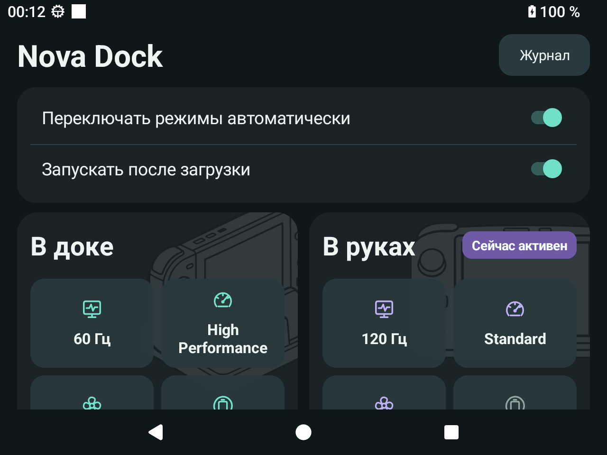
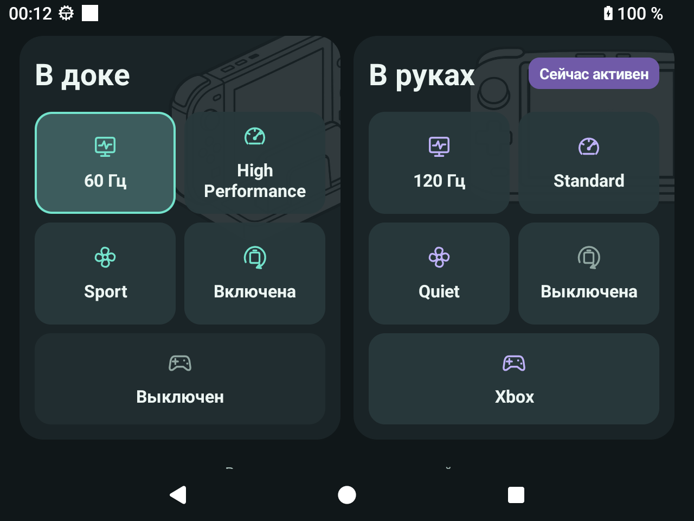

# Nova Dock

Локальный прототип для **Retroid Pocket Nova, Android 13**. Подготовлен по компонентам прошивки `RPN_V1.0.0.436_20260722_083524_user`.

Настройки по умолчанию:

| Настройка | В доке | В руках |
|---|---|---|
| Частота | 60 Гц | 120 Гц |
| Контроллер | Выключен | Xbox |
| Вентилятор | Максимум, Custom 35000 | Quiet |
| Производительность | High Performance | Standard |
| Обходная зарядка | Включена | Выключена |

Приложение использует те же системные настройки, что штатные плитки Retroid, через встроенный сервис прошивки `PServerBinder`. Штатное отключение подсветки при выводе на ТВ настраивается в Retroid; Nova Dock его не меняет. Получать root, устанавливать Shizuku или выдавать системные разрешения через ADB не требуется. В манифесте отсутствуют разрешения на интернет и `WRITE_SECURE_SETTINGS`.

## Установка

Установить APK, открыть **Nova Dock** и включить **«Переключать режимы автоматически»** либо выбрать режим вручную. На Android 13 разрешить уведомления: в постоянном уведомлении видны режим и кнопка остановки.

```sh
adb install -r Nova-Dock-0.4.0.apk
```

Отключение автопереключения сохраняет текущий режим и значения. Внизу экрана есть восстановление настроек, сохранённых перед первым применением профиля. Перед удалением приложения используйте восстановление, если хотите вернуть исходную конфигурацию устройства.

## Автоматическое и ручное переключение

Верхний блок содержит два одинаковых переключателя:

- **«Переключать режимы автоматически»** — следить за внешним дисплеем и применять сохранённый профиль при подключении или отключении.
- **«Запускать после загрузки»** — возобновлять последний активный способ управления после загрузки Android.

Когда автопереключение выключено, в третьей строке появляются кнопки **«В доке»** / **«В руках»**. Выбор другого режима применяет весь его сохранённый профиль независимо от подключённого дисплея. Подключение кабеля и события питания не меняют ручной режим. Повторное нажатие уже активного режима сохраняет временные изменения.

Плитки активной карточки работают сразу и в ручном режиме. Текущий выбор отмечен бейджем. Дублирующих обычных сводок в верхнем блоке нет; ошибки, ожидание и действие повтора появляются только при необходимости.

## Автозапуск после перезагрузки

**«Запускать после загрузки»** включён по умолчанию и действует как для автоматического, так и для ручного управления. Его выключение сохраняет текущую сессию, но запрещает запуск после следующей перезагрузки. Ручное открытие приложения возобновляет сессию, если она не была явно остановлена.

Кнопка остановки в уведомлении прекращает управление, оставляя текущие значения устройства. Восстановление исходных настроек также останавливает управление. Чтобы начать новую сессию, выберите ручной режим или включите автопереключение. Обновление APK возобновляет активную сессию независимо от настройки автозапуска.

На 0.3.0 проверены реальные автоматические перезагрузки с внешним дисплеем и без него, без открытия Nova Dock. На 0.4.0 также проверена настройка запуска реальными перезагрузками с включённым и выключенным автозапуском. Прошивка и ограничения проверки указаны ниже.

## Настройка плитками

Нажатие на плитку переключает значение по кругу и сразу сохраняет его. В активной карточке выбранная настройка также применяется сразу; в другой — сохраняется до переключения режима. Модальных редакторов и кнопок «Настроить» / «Сохранить» больше нет.

- **Частота:** «Не менять» → 60 Гц → 120 Гц. «Не менять» не записывает параметры частоты и не восстанавливает прежнее значение.
- **Производительность:** Standard → Performance → High Performance.
- **Вентилятор:** выключен, Quiet, Smart, Sport или максимум в зависимости от производительности. В Performance нельзя выключить вентилятор, в High Performance доступны Smart, Sport и максимум. Для активной карточки учитывается и фактическая производительность.
- **Обходная зарядка:** включена / выключена. По умолчанию **включена в доке и выключена в портативном режиме**; обновление сохраняет прежние пользовательские значения.
- **Контроллер:** Xbox / Retro в портативном режиме. Док-профиль отключает встроенный контроллер.

При смене производительности совместимый текущий режим вентилятора сохраняется, включая пользовательскую скорость. Если он несовместим, используется Smart. Режим самого внешнего дисплея выбирает прошивка Retroid.

### Ручные изменения в шторке

Выбранные в штатной шторке значения действуют до следующего перехода док / портативный режим или новой сессии управления. Приложение больше не возвращает их периодически после событий питания и пробуждения. В активной карточке видны фактические значения; подпись **«Сохранено: …»** показывает значение профиля, если оно отличается.

Нажатие плитки приложения сохраняет и применяет выбранную настройку, сохраняя остальные временные значения, кроме необходимых зависимостей вентилятора и производительности. При следующей смене режима применяется весь сохранённый профиль.

Обходная зарядка использует штатный режим Retroid. Ограничения зарядки, работа во сне и тепловая защита остаются под управлением прошивки. Например, обходную зарядку можно временно выключить в шторке, чтобы зарядить Nova в доке; при следующем переходе в док вернётся сохранённое значение.

### Управление геймпадом

**Крестовина** перемещает выделение, **A** нажимает выбранную плитку или действие, **B** возвращает назад и закрывает диалоги. Фокус выделяется яркой скруглённой рамкой; экран прокручивается к выбранному элементу.

**«Журнал»** открывает широкий список событий: время в одну строку, промежутки между записями и цветные статусы. Действие **«Применить снова»** появляется только после ошибки применения.

## Скриншоты с устройства

Сняты непосредственно с Retroid Pocket Nova, версия 0.4.0, разрешение 1280 × 960. По подписи открывается исходное изображение. Значения на скриншотах — сохранённые настройки владельца.

| [Главный экран](images/overview.png) | [Плитки режимов](images/profiles.png) |
|---|---|
|  |  |
| [Журнал](images/journal.png) | [Фокус геймпада](images/controller-focus.png) |
|  |  |

[Ручной выбор режима](images/manual-mode.png) появляется третьей строкой при выключенном автопереключении.

## Технические детали

- Определение видеовыхода: `/sys/class/drm/card0-DP-1/status`; резерв — `sys.dp.isconnect`, `persist.sys.hdmiisconnect` и наличие presentation-дисплея. Недоступное состояние не считается отключением.
- `DisplayManager` и события Retroid ускоряют проверку; повторная проверка выполняется примерно каждые 1,2 с без постоянного WakeLock.
- Устойчивое подключение 1,2 с, отключение 2,2 с. Это подавляет краткие обрывы сигнала.
- Фоновая foreground-служба, `START_STICKY`, запуск по `BOOT_COMPLETED` при включённом автозапуске и после обновления APK, если сессия управления активна. Автоматический и ручной режимы поддерживают возобновление; устойчивость к фирменному убийству фоновых процессов пока не проверена.
- При явном применении настроек приложение даёт прошивке завершить изменение производительности/зарядки, затем восстанавливает совместимый вентилятор. Последующие ручные изменения не переписываются до следующей смены режима.
- Изменения плиток проходят через один рабочий поток: повторные запросы объединяются, интерфейс ожидает подтверждения применения последнего запроса.
- `PServerBinder` — привилегированный сервис производителя, выполняющий команды от root. Приложение отправляет ему только чтение `id` для диагностики и операции `settings put/delete system` по девяти ключам ниже. Имена проверяются по фиксированному списку, значения — по числовому формату. В приложении нет внешнего IPC-интерфейса выполнения команд. Это не публичный Android API, совместимость после OTA требует повторной проверки.
- Сеть, пользовательские файлы, игры и настройки эмуляторов не используются.
- Прототип не обещает сохранение игрового сеанса или привязок внешнего геймпада во всех эмуляторах; это зависит от конкретного приложения и режима вывода Retroid.

Изменяемые `Settings.System`:

```text
min_refresh_rate
peak_refresh_rate
performance_mode
fan_mode
fan_speed
temp_abxy_layout_mode
no_create_gamepad_button_layout
flip_button_layout
is_charging_separation
```

`performance_mode=0` называется **Standard** в интерфейсе этой прошивки, хотя внутренний enum использует имя NORMAL. Максимальная производительность — `2`. Quiet — `fan_mode=1`; максимальная пользовательская скорость — `fan_mode=6`, `fan_speed=35000`. Это верхняя граница пользовательского ползунка для ветки устройств Nova/Mini; тепловая защита прошивки не изменяется.

## Сборка и проверки

Нужны Python 3, JDK 17, Android SDK Platform 35 и Build Tools 35.0.0. Загрузки зависимостей не требуются.

```sh
python3 build.py
```

Пути можно задать через `ANDROID_SDK_ROOT` / `ANDROID_HOME`, `NOVA_JAVA_HOME` / `JAVA_HOME`, `NOVA_BUILD_DIR`, `NOVA_APK_PATH`. APK появляется в `dist/Nova-Dock-0.4.0.apk`. Поддерживаются macOS и Linux. Локальный ключ подписи создаётся в `keys/`; сохраните его для установки будущих обновлений без переустановки. Это ключ для разработки, пароль `android`. APK отладочный, не предназначен для публикации в магазине. Ключ хранится отдельно в локальной папке исходников и не включается в Git. Сборка с другим ключом не установится поверх опубликованного APK без удаления предыдущей версии.

Сборка проверяет подпись APK, тесты подавления кратких обрывов/неопределённого состояния и очереди изменений настроек и переходов управления. Чтение состояния устройства:

```sh
adb shell am instrument -w local.nova.dock/.DeviceCheck
```

Проверка профилей временно применяет оба профиля и восстанавливает исходные настройки. Выполнять при отключённом внешнем дисплее:

```sh
adb shell am instrument -w -e profiles true local.nova.dock/.DeviceCheck
```

Исходники системных APK, снятых для диагностики, в этот проект не включены. Реализация написана отдельно по проверенному порядку и значениям настроек прошивки.

## Проверено на устройстве 24–25.11.2026

- Установка и открытие интерфейса на Nova, Android 13, сборка `RPN_V1.0.0.436`.
- Работа штатного `PServerBinder` из обычного процесса приложения. `WRITE_SECURE_SETTINGS` отозван и отсутствует в установленном манифесте.
- Чтение реального состояния DisplayPort приложением.
- Док-профиль: фактическая частота `60.000004` Гц, PWM вентилятора `35000`, игровые контроллеры отсутствуют в `InputDevice`.
- Портативный профиль: фактическая частота `120.00001` Гц, Quiet, PWM `12000`, появляется `Xbox Wireless Controller`.
- Проверено соответствие всех восьми настроек обоим профилям. После самопроверки исходные настройки восстановлены.
- Запущена foreground-служба и включена автоматика; без внешнего дисплея она применила портативный профиль.
- Пройдены тесты короткого обрыва, переподключения и неопределённого состояния датчика; подпись APK проверена.

Владелец проверил физическое подключение телевизора и отключение от него: по первому впечатлению всё работает. Журнал подтвердил оба перехода, без повторных применений профиля в течение сеанса.

Для 0.2.0 проверены пользовательский док-профиль Smart/Performance без изменения частоты и портативный Sport/Performance/Retro на 60 Гц. Восстановление выбранного Quiet после штатного Smart при смене статуса зарядки заняло около 1,7 с; частота и идентификатор контроллера не изменились. Исходные значения после диагностических тестов восстановлены.

Для 0.3.0 проверены включение и выключение штатного переключателя обходной зарядки и состояние драйвера: включённому режиму соответствует `usb_charge_now=0`, выключенному — `1`. Проверены обратные пользовательские значения, сохранение через интерфейс, обновление ранее сохранённого снимка исходных настроек и точное восстановление всех девяти значений. Прежние настройки профилей сохранены.

Реальная перезагрузка на 0.3.0 без внешнего дисплея также прошла проверку: `BOOT_COMPLETED` запустил foreground-службу без открытия интерфейса. Примерно через три секунды после старта службы применился сохранённый портативный профиль: 120 Гц, Xbox, Quiet, Standard, обычная зарядка (`usb_charge_now=1`). Настройки профилей и снимок исходных значений не изменились.

Затем владелец перезагрузил Nova с подключённым внешним дисплеем и вернул её к компьютеру. Новая загрузка и состояние службы подтвердили автозапуск по `BOOT_COMPLETED`. Журнал зафиксировал сохранённый док-профиль 60 Гц / Sport примерно через две секунды после старта службы и возврат в портативный режим при отключении дисплея. Ошибок применения нет; настройки профилей и снимок исходных значений сохранились.

Для 0.4.0 на устройстве проверены временные ручные значения, изменение одной плитки без сброса остальных настроек, быстрые серии нажатий, сохранение пользовательской скорости вентилятора и порядок зависимых изменений производительности/вентилятора. Повторно прошли оба полных профиля и пользовательские пресеты, включая драйвер зарядки и точное восстановление девяти настроек. Проверены события Android-геймпада: крестовина, A/B, смена значений и диалоги; отдельные модели внешних контроллеров пока не проверялись.

Ещё две реальные перезагрузки подтвердили работу настройки автозапуска: при выключенном служба не запускалась, при включённом запускалась по `BOOT_COMPLETED` и применяла портативный профиль без открытия приложения. Ручное открытие возобновляло ранее включённую автоматику. Настройки профилей и исходный снимок сохранились.

В ручном режиме 0.4.0 проверены сохранение временных значений при выключении автопереключения, работа режима «В доке» без внешнего дисплея, повторный выбор того же режима без сброса значений и немедленное применение активных плиток. Быстрые переходы завершались последним выбранным режимом. Восстановление исходных настроек останавливало управление; повторное открытие их не меняло. Полная самопроверка также точно восстановила снимок всех настроек приложения с активной ручной сессией.

Затем выполнены две реальные перезагрузки с ручным режимом «В доке»: при выключенном автозапуске служба оставалась остановленной до открытия приложения; при включённом `BOOT_COMPLETED` возобновлял ручной док-профиль без открытия Nova Dock и без внешнего дисплея. Драйвер подтвердил включённую обходную зарядку. Настройки профилей, исходный снимок и выбранный автозапуск сохранились.

Длительная работа в фоне, инструментальное измерение плавности ТВ и поведение каждого эмулятора остаются непроверенными.

Дополнительная проверка пользовательских профилей:

```sh
adb shell am instrument -w -e profiles true -e customProfiles true local.nova.dock/.DeviceCheck
adb shell am start -n local.nova.dock/.MainActivity
```

Инструментальный тест перезапускает процесс приложения. После любого такого теста откройте Nova Dock: активная автоматическая или ручная сессия возобновится.
